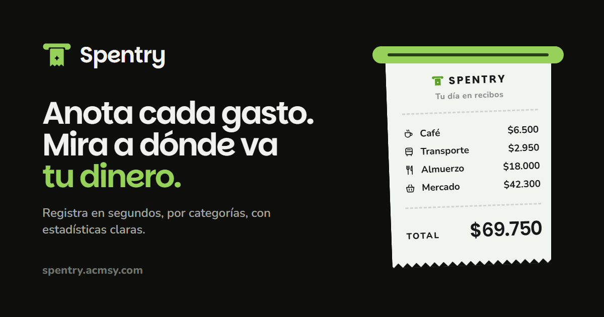
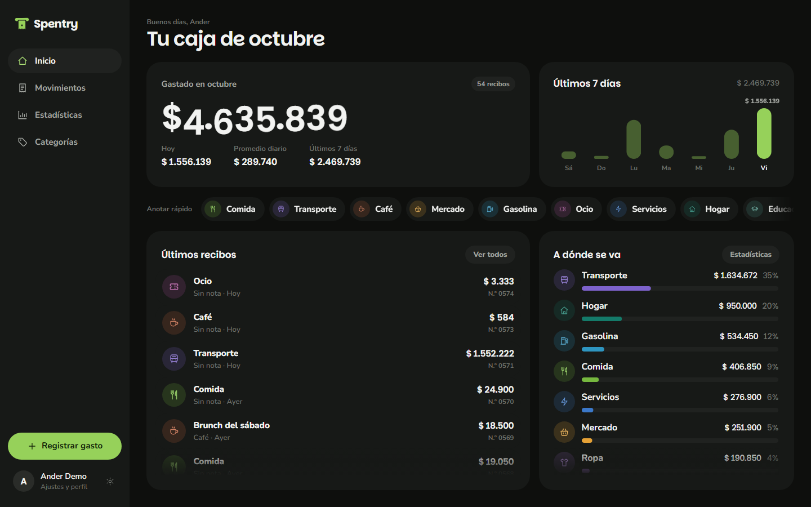
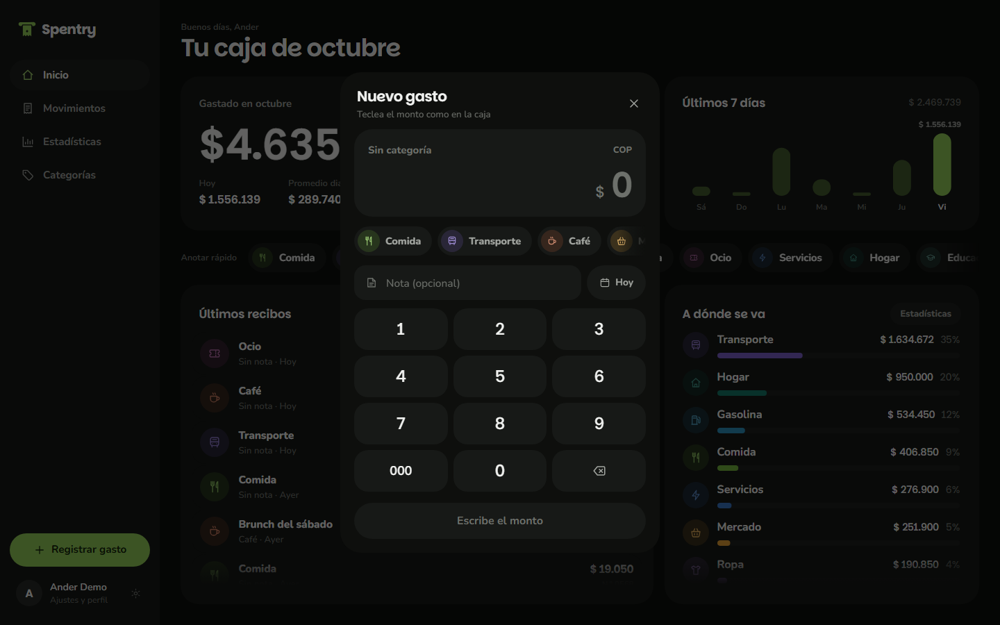
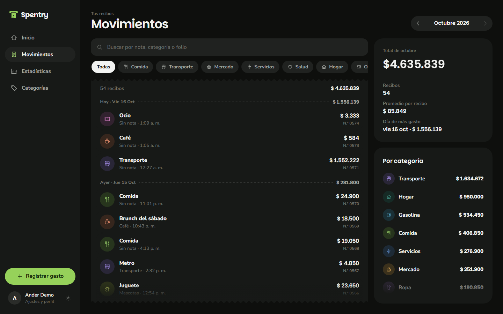
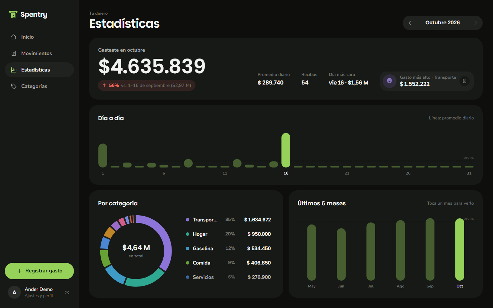
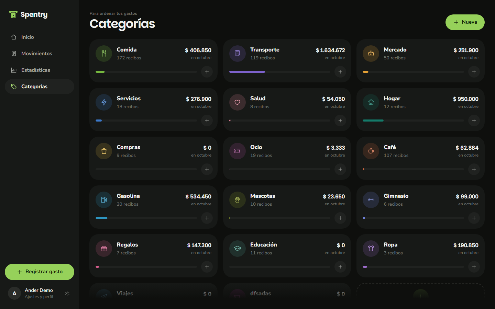
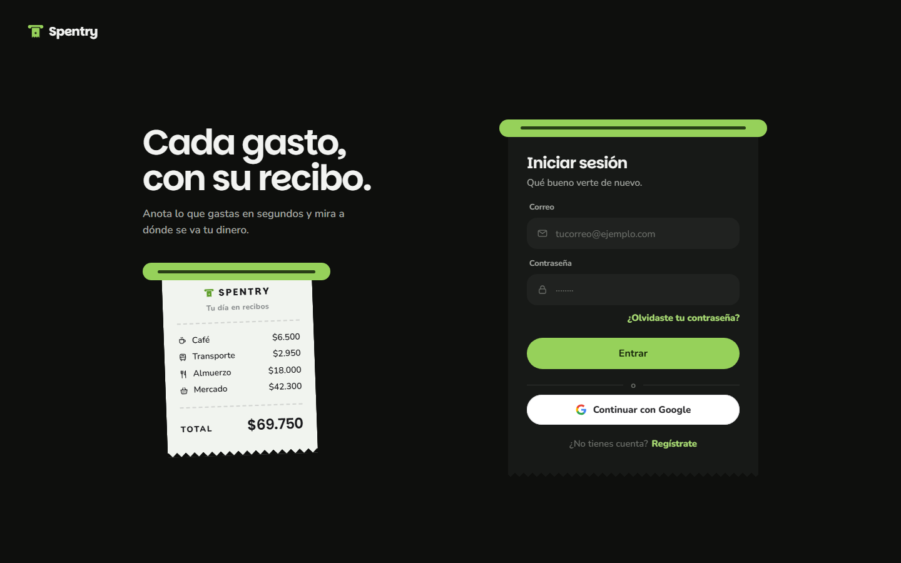
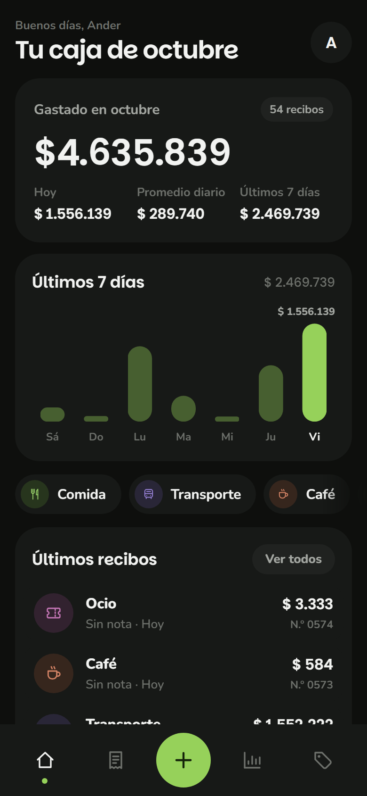
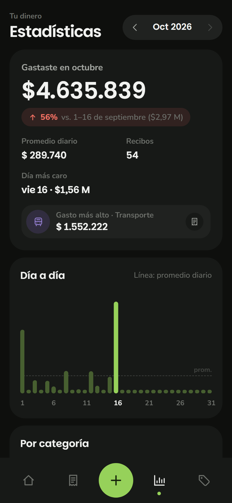

<div align="center">


# Spentry

**Anota cada gasto. Mira a dónde va tu dinero.**

Una caja registradora en tu bolsillo: tecleas el monto, eliges la categoría<br />
y el gasto sale impreso como un recibo. Funciona en el celular y en la PC, y se instala como app.

[**spentry.acmsy.com**](https://spentry.acmsy.com)

<br />


<br />



</div>

<br />

## Qué hace

| | |
|---|---|
| **Registro en segundos** | Un teclado tipo caja registradora. Tecleas el monto, eliges la categoría y listo: el recibo sale impreso por la ranura. |
| **Recibos con folio** | Cada gasto queda como un recibo numerado, con fecha, hora, categoría y nota opcional. Desde su detalle se edita, o se anula manteniendo presionado el botón. |
| **Categorías a tu medida** | Nombre, icono y color propios, con un selector de color personalizado. |
| **Movimientos** | La cinta del mes con búsqueda por nota, categoría o folio, y filtro por categoría. |
| **Estadísticas** | Total del mes, comparación con el mes anterior, promedio diario, día más caro, gasto día a día, reparto por categoría y los últimos 6 meses. |
| **Presupuesto y recordatorio** | Presupuesto mensual opcional y una notificación diaria para no olvidar anotar. |
| **Tus datos** | Exporta todos tus recibos a CSV. Seis monedas: COP, USD, EUR, MXN, PEN y CLP. |
| **Claro, oscuro o sistema** | El cambio de tema se revela en círculo desde donde tocas. |

<br />

## Capturas

<table>
  <tr>
    <td width="50%"></td>
    <td width="50%"></td>
  </tr>
  <tr>
    <td align="center"><sub><b>Inicio</b> · el total del mes, los últimos 7 días y a dónde se va</sub></td>
    <td align="center"><sub><b>La caja</b> · el monto se teclea como en una caja registradora</sub></td>
  </tr>
  <tr>
    <td width="50%"></td>
    <td width="50%"></td>
  </tr>
  <tr>
    <td align="center"><sub><b>Movimientos</b> · la cinta de recibos del mes</sub></td>
    <td align="center"><sub><b>Estadísticas</b> · día a día, por categoría y por mes</sub></td>
  </tr>
  <tr>
    <td width="50%"></td>
    <td width="50%"></td>
  </tr>
  <tr>
    <td align="center"><sub><b>Categorías</b> · cuánto lleva cada una este mes</sub></td>
    <td align="center"><sub><b>Entrar</b> · la tarjeta se imprime desde la ranura</sub></td>
  </tr>
</table>

<div align="center">
  
  &nbsp;
  
  <br />
  <sub>En el celular se ve todo lo de la PC, en una columna, con la barra de pestañas abajo.</sub>
</div>

<br />

## Diseño

Spentry gira alrededor de una sola idea: **cada gasto es un recibo**. Esa metáfora decide el
movimiento, no al revés.

- **La caja imprime.** Al registrar, el papel sale de la ranura a tirones, se sostiene un instante y se arranca. El modal se encoge a la medida del recibo mientras imprime.
- **Cada vista entra según lo que muestra.** La cinta de Movimientos se imprime de arriba abajo, las filas aparecen como líneas de recibo, los iconos de Categorías se dibujan trazo a trazo y los gráficos se trazan desde cero.
- **Las cifras ruedan** como el visor mecánico de una caja, dígito por dígito.
- **Hover sin mover nada.** Las tarjetas se tiñen de su color y su contenido se anima en su sitio; nada sube ni se agranda.
- **Oscuro casi neutro** con un toque mínimo de verde, un solo acento (`#96D15A`) y colores de categoría verificados para que se distingan entre sí.
- **Todo a pantalla completa**, sin scroll general en la PC: cada lista hace scroll por dentro, con un desvanecido que avisa que hay más.
- **Tipografía redondeada:** Parkinsans para títulos y cifras, Nunito para el texto.

<br />

## Stack

| Capa | Tecnología |
|---|---|
| Aplicación | **Nuxt 4** en modo SPA, **Vue 3.5**, TypeScript |
| Estilos | Tailwind CSS (sin preflight) y CSS propio con tokens de diseño |
| Servidor | Nitro (API en `server/api`) |
| Datos | **MySQL 8** con `mysql2` |
| Sesión | Cookie firmada con HMAC y contraseñas con `scrypt`; Google OAuth opcional |
| PWA | `@vite-pwa/nuxt` con service worker propio (`injectManifest`) |
| Notificaciones | Web Push con VAPID (`web-push`) y un programador diario |
| Despliegue | Docker sobre acmsy, detrás de Cloudflare |

<br />

## Estructura

```
Spentry/
  assets/css/        main.css (tokens y base) · layout.css (vistas) · receipt.css (caja y recibos)
  components/        Interfaz: caja, recibo, gráficos, selectores, popover, toaster…
  composables/       useDatos (datos y estadísticas) · useTema · useUi · usePush
  layouts/           default (barra lateral y pestañas) · auth
  pages/             index · movimientos · estadisticas · categorias · ajustes · login
  server/
    api/             auth, gastos, categories, profile, push, data
    utils/           db, sesión, usuarios, datos, push, Google
    plugins/         programador del recordatorio diario
  service-worker/    sw.ts (precaché y notificaciones)
  db/                01-schema.sql
  scripts/           db-init.mjs · seed-demo.mjs
  public/            iconos, logo, imagen para compartir, robots, sitemap, llms.txt
```

<br />

## Cómo correr en local

Necesitas **Node 22+** y **MySQL 8**.

```bash
npm install
```

Copia `.env.example` como `.env` y completa los valores (ver abajo). Luego crea las tablas:

```bash
npm run db:init
```

Opcional: una cuenta demo con unos tres meses de gastos (usa `DEMO_PASSWORD` del `.env`):

```bash
npm run db:demo
```

```bash
npm run dev
```

Abre <http://localhost:3040>.

<br />

## Variables de entorno

| Variable | Para qué |
|---|---|
| `DB_HOST` · `DB_PORT` · `DB_USER` · `DB_PASSWORD` · `DB_NAME` | Conexión a MySQL (o `DATABASE_URL` en su lugar) |
| `SESSION_SECRET` | Firma de la cookie de sesión: una cadena larga y aleatoria |
| `ORIGIN` | URL pública de la app (para OAuth y enlaces) |
| `VAPID_PUBLIC` · `VAPID_PRIVATE` · `VAPID_SUBJECT` | Web Push. Se generan con `npx web-push generate-vapid-keys` |
| `CRON_SECRET` | Protege el disparo manual del recordatorio |
| `GOOGLE_CLIENT_ID` · `GOOGLE_CLIENT_SECRET` · `GOOGLE_REDIRECT_URI` | Inicio de sesión con Google (opcional) |
| `DEMO_PASSWORD` | Contraseña de la cuenta demo local |

El `.env` nunca se sube al repositorio.

<br />

## Scripts

| Comando | Qué hace |
|---|---|
| `npm run dev` | Servidor de desarrollo en el puerto 3040 |
| `npm run build` | Compila para producción en `.output/` |
| `npm run db:init` | Crea las tablas en MySQL |
| `npm run db:demo` | Crea la cuenta demo con datos de ejemplo |
| `npm run typecheck` | Revisa los tipos |

<br />

## PWA, SEO y despliegue

- **Instalable** en Android, iOS y PC. Los colores de la barra del sistema y de la pantalla de inicio salen del manifiesto, en oscuro; la barra de estado sigue el tema desde el primer cuadro.
- **`sw.js` y el manifiesto nunca se cachean**, para que cada despliegue llegue de inmediato a las apps instaladas.
- **Vista previa al compartir** con Open Graph y tarjeta grande de X; **datos estructurados** (`WebApplication`), `robots.txt`, `sitemap.xml` y `llms.txt` para buscadores e IAs.
- **Despliegue:** la imagen de Docker compila la app y la sirve con Nitro en el puerto 3000.

```bash
docker build -t spentry .
docker run -p 3000:3000 --env-file .env spentry
```

<br />

<div align="center">
  
  <br />
  <sub>Hecho por <b>Ander</b></sub>
</div>
